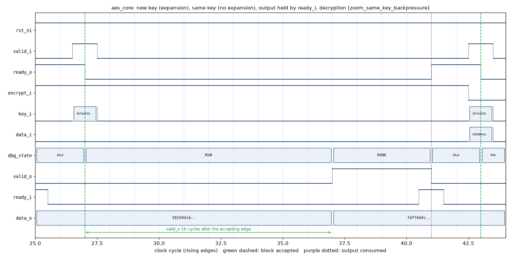
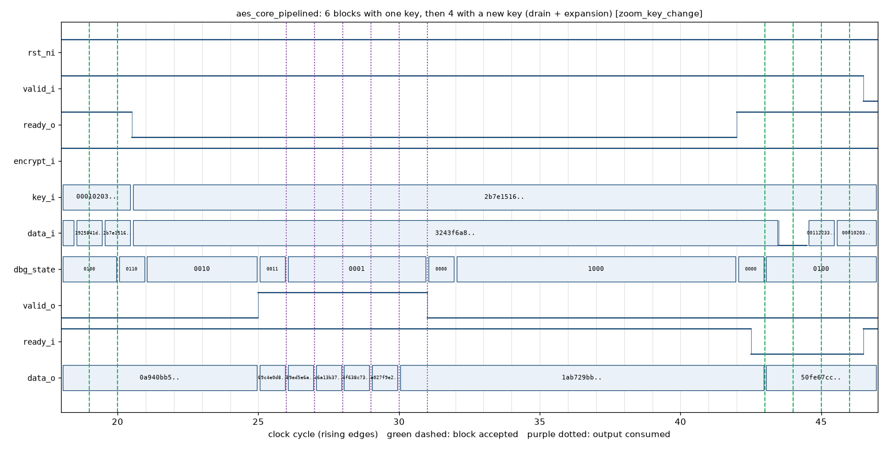

# aes128-fpga-core

[](https://github.com/ayoub-ac/aes128-fpga-core/actions/workflows/ci.yml)
[](LICENSE.md)

> **Status: verified in simulation only.** v1.1.0 passes FIPS-197
> Appendix B and C.1, the VarTxt and VarKey sweeps and 2000 random vectors
> from an independent reference (OpenSSL through the Python `cryptography`
> package), encrypting and decrypting, on all three cores, plus the
> original directed tests. It has not been run on FPGA hardware, synthesised
> with Vivado or Quartus, validated under NIST CAVP/CMVP, or evaluated for
> side-channel or fault-injection resistance. It was written with AI
> assistance. No support or maintenance is provided. See
> [Verification](#verification) for what was and was not checked.

An AES-128 IP core in SystemVerilog: one round per clock cycle, encryption
and decryption on a shared datapath, a valid/ready handshake on both sides,
a single clock domain and a synchronous active-low reset. Two variants: a
fully unrolled encrypt-only pipeline that takes one block per cycle, and an
iterative core with a fault-detecting round counter.

## Quickstart

```bash
git clone https://github.com/ayoub-ac/aes128-fpga-core.git
cd aes128-fpga-core
make lint test test-secure    # Verilator lint and the directed tests
make test-vectors             # independent vector regression, all three cores
make waves                    # timing plots in build/waves
make synth_report             # Yosys synthesis numbers -> SYNTH_REPORT.md
```

Tested with Verilator 5.053 and Yosys 0.70 (OSS CAD Suite 2026-11-01).
`make test-vectors` needs Python 3 with `cryptography`; `make waves` needs
`matplotlib` and `vcdvcd`. Select the interpreters with `PYTHON=` and
`PLOT_PYTHON=`.

## Architecture

```
                  +-----------------+
       key_i ---->|                 |
      data_i ---->|    aes_core     |----> data_o
   encrypt_i ---->|  (FSM + round)  |
     valid_i ---->| ready_o valid_o |----> valid_o
     ready_i ---->|                 |----> ready_o
                  +--------+--------+
                           |
              +------------+------------+
              |            |            |
        aes_key_expand  aes_round   aes_sbox /
        (1 key/cycle)   (combo)     aes_inv_sbox
                                    (table)
```

FSM: `IDLE -> EXPAND (10 cycles) -> RUN (10 cycles) -> DONE -> IDLE`. The 11
round keys are stored; a block whose key equals the stored key skips
`EXPAND`. A reset clears the stored key.

| Core | valid_o after the accepting edge | Back-to-back blocks |
|---|---|---|
| `aes_core`, same key as the previous block | 10 cycles | 12 cycles per block |
| `aes_core`, new key | 20 cycles | 22 cycles per block |
| `aes_core_secure` (expands every key) | 20 cycles | 22 cycles per block |
| `aes_core_pipelined`, same key | 10 cycles | 1 cycle per block |
| `aes_core_pipelined`, new key | drains the pipeline, then 10 cycles of expansion | |

The result can be taken on the rising edge after `valid_o` rises, so
"10 cycles" means the 11th edge after acceptance. `make test` measures 16
back-to-back blocks with one key in 202 cycles (22 for the first, 12 for
each of the others).

## Port table

| Signal      | Dir | Width | Description |
|-------------|-----|-------|-------------|
| `clk_i`     | in  | 1     | System clock. All flops sample on the rising edge. |
| `rst_ni`    | in  | 1     | Synchronous active-low reset. One clock cycle is enough; `ready_o` is low while it is asserted. |
| `key_i`     | in  | 128   | AES-128 key. Byte 0 in bits [127:120]. |
| `data_i`    | in  | 128   | Plaintext (`encrypt_i = 1`) or ciphertext (`encrypt_i = 0`). |
| `encrypt_i` | in  | 1     | 1 = encrypt, 0 = decrypt. Ignored by `aes_core_pipelined`. |
| `valid_i`   | in  | 1     | Block offered. Accepted on a rising edge where `valid_i && ready_o`. |
| `ready_o`   | out | 1     | Core accepts a block this cycle. |
| `data_o`    | out | 128   | Result. Held while `valid_o && !ready_i`. |
| `valid_o`   | out | 1     | Result available. |
| `ready_i`   | in  | 1     | Consumer takes the result on a rising edge where `valid_o && ready_i`. |

`aes_core_secure` adds `random_i` (128-bit mask, sampled on acceptance) and
the sticky `fault_o`. See [`PORT_DESCRIPTION.md`](PORT_DESCRIPTION.md) for the
handshake details and the timing plots.

## Measured numbers

Yosys 0.70 synthesis, flattened, from `make synth_report` (basic core) and
`make synth-secure` / `make synth-pipelined` (Xilinx). Fmax from nextpnr 0.11,
ECP5 CABGA381, out of context, seeds 1 to 3.

| Core | Target | LUT | FF | Block RAM | Fmax |
|---|---|---|---|---|---|
| `aes_core` | iCE40 | 7902 LUT4 | 1674 | 32 SB_RAM40_4K | not placed |
| `aes_core` | ECP5 | 25086 LUT4 + 12313 PFUMX/L6MUX21 | 1930 | 0 | LFE5U-45F (57 %): 32.2 - 34.6 MHz |
| `aes_core` | Xilinx 7-series | 5437 LUT6 + 537 MUXF7/8 | 1930 | 0 | not placed |
| `aes_core_secure` | Xilinx 7-series | 7055 LUT6 + 274 MUXF7/8 | 1805 | 0 | not placed |
| `aes_core_pipelined` | Xilinx 7-series | 11538 LUT6 + 2490 MUXF7/8 | 4757 | 0 | not placed |

- The basic core does **not** fit an iCE40 UP5K or HX8K (5280 / 7680 LUT4),
  so it was not placed on iCE40. On ECP5 it needs 103 % of a LFE5U-25F and
  does not place there; use a LFE5U-45F or larger. Most of the area is the
  36 table S-boxes and the 11 x 128-bit key store.
- Yosys / ABC results move by a few percent with small RTL changes: the
  previous revision of this branch synthesised to 24113 LUT4 and placed on
  a LFE5U-25F at 99 % (38 - 39 MHz). Do not plan on the 25F.
- At 33 MHz on ECP5 the basic core moves 128 bits every 12 cycles with one
  key, about 350 Mbit/s (computed from the cycle count, not measured on
  hardware).
- Vivado and Quartus were not run. See [`SYNTH_REPORT.md`](SYNTH_REPORT.md)
  and [`RESOURCE_ESTIMATES.md`](RESOURCE_ESTIMATES.md).

## Verification

Everything below runs in CI on every push (`.github/workflows/ci.yml`).

| Check | What it covers | Result (v1.1.0) |
|---|---|---|
| `make lint` | Verilator `-Wall` on the three cores and the testbenches | clean |
| `make test` | 10 directed groups: FIPS-197 B/C.1 and SP 800-38A F.1.1 vectors both ways, round trips, back-to-back timing, edge keys, 1000 random round trips, key changes, reset mid-operation, a 50-cycle stall, 100 vectors cross-checked with pycryptodome; 5 SVA properties every cycle; 9/9 coverage bins | pass |
| `make test-secure` | the secure core: vectors, mask invariance, a forced counter fault raising `fault_o` | pass |
| `make test-vectors` | 2516 vectors from `cryptography` (FIPS-197 B/C.1, VarTxt, VarKey, 2000 random). Iterative cores: every vector encrypted and decrypted with random gaps and back-pressure, decryption with a new key, 64 resets of 1 to 4 cycles mid-operation, `valid_i` driven during reset, latency recorded. Pipelined core: 1920 blocks in 13 streams with one key, the zero key and a new key per block, with and without back-pressure, and after 8 resets of a full pipeline | 0 errors (6774 + 6774 + 1920 checks) |
| `make waves` | three checked scenarios rendered as timing plots | pass |





Not verified: FPGA hardware; Vivado and Quartus; place and route on iCE40 or
Xilinx; formal proofs (none exist); NIST CAVP/CMVP; power, EM and fault
attacks; mixed-language simulation of the VHDL wrapper.

## Variants

| File | Description |
|---|---|
| `rtl/aes_core.sv` | Iterative core, encrypt and decrypt, stored key schedule |
| `rtl/aes_core_pipelined.sv` | Fully unrolled, encrypt only, one block per cycle |
| `rtl/aes_core_secure.sv` | Iterative core with a duplicated round counter (`fault_o`) and a masked state register. The mask does not protect against power or EM analysis; see [`SECURITY.md`](SECURITY.md) |
| `vhdl_wrapper/aes_core_vhdl.vhd` | VHDL-2008 entity around the SystemVerilog core; analysed with GHDL only |

## License

Dual-licensed:

- **GPL-3.0-or-later** for open-source projects. If your product links this
  RTL or its compiled bitstream, your project must also be GPL-3.0+.
- **Commercial license** for closed-source products, on request: open a
  GitHub issue titled "Commercial license request". Do not post confidential
  details in the issue. Any commercial license is provided as is, without
  warranty, support or maintenance.

See [`LICENSE.md`](LICENSE.md).

## Repository layout

```
rtl/                  RTL sources
  aes_core.sv           iterative core, FSM, round-key store
  aes_core_pipelined.sv fully unrolled variant
  aes_core_secure.sv    variant with a duplicated round counter
  aes_round.sv          SubBytes/ShiftRows/MixColumns and inverses
  aes_key_expand.sv     one key-expansion step
  aes_sbox.sv           forward S-box table (FIPS-197 Fig. 7)
  aes_inv_sbox.sv       inverse S-box table (FIPS-197 Fig. 14)
tb/
  sim_main.cpp          C++ harness for make test
  sim_secure.cpp        C++ harness for make test-secure
  aes_core_tb.sv        DUT wrapper with assertions and coverage
  aes_core_assertions.sv, aes_core_cov.sv
  tb_vectors.sv         independent vector regression (make test-vectors)
  tb_waves.sv           waveform scenarios (make waves)
  nist_vectors.sv, random_vectors.h, gen_random_vectors.py
scripts/              synth_report.sh, gen_vectors.py, plot_waves.py, vhdl_cosim.sh
docs/waves/           timing plots shown above
vhdl_wrapper/         VHDL-2008 wrapper
```

## Contributing

Bug reports and patches welcome. Run `make lint test test-secure
test-vectors` before opening a pull request; CI runs the same targets.

## Citation

```bibtex
@misc{aes128-fpga-core,
  title  = {{aes128-fpga-core}: a dual-licensed AES-128 IP core in SystemVerilog},
  author = {Achour, Ayoub},
  year   = {2026},
  howpublished = {\url{https://github.com/ayoub-ac/aes128-fpga-core}}
}
```

## References

- NIST FIPS-197, *Advanced Encryption Standard*, November 2001.
- NIST SP 800-38A, *Recommendation for Block Cipher Modes of Operation*.
- NIST, *The Advanced Encryption Standard Algorithm Validation Suite (AESAVS)*.

## Author

Ayoub Achour - [github.com/ayoub-ac](https://github.com/ayoub-ac)
